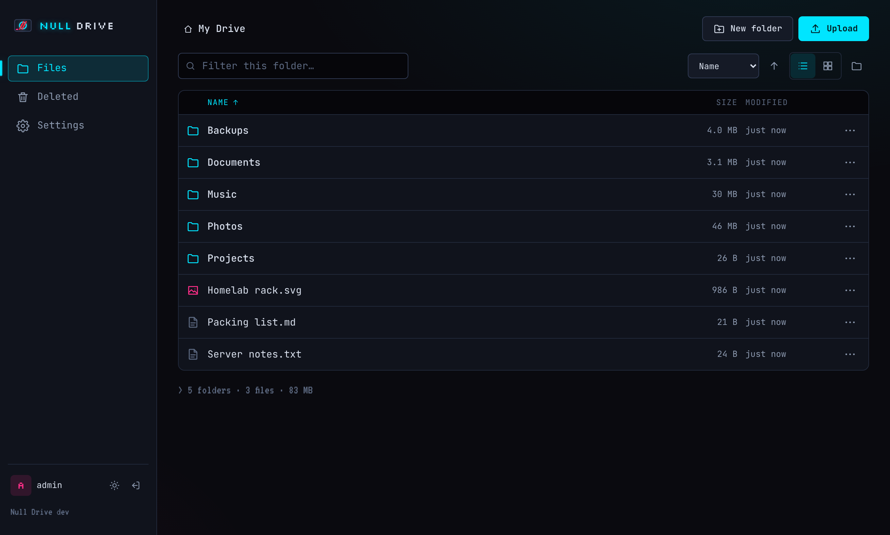
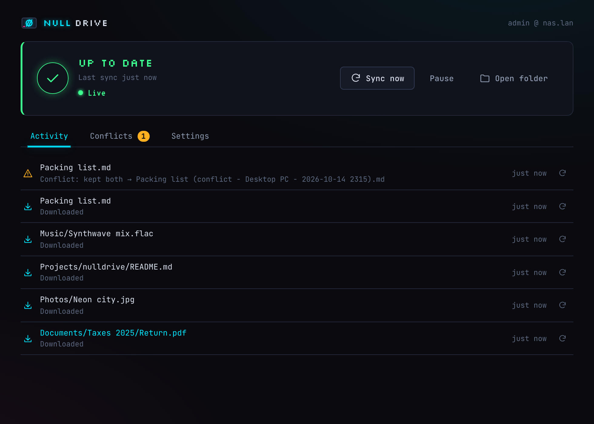
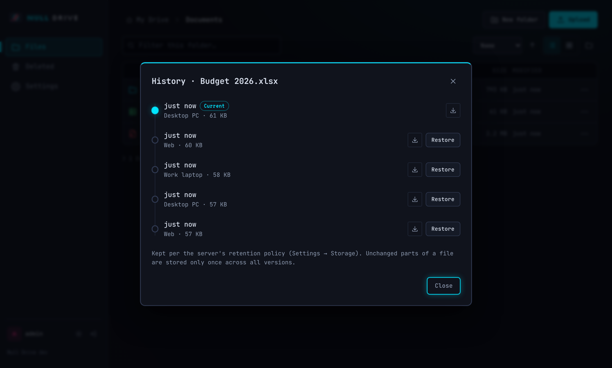
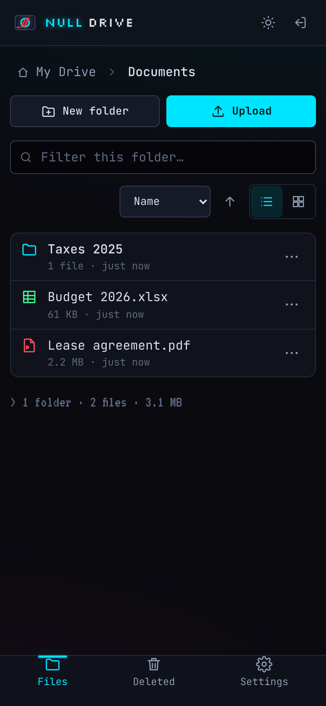

# Null Drive

**Your own file sync server. Like Dropbox, but you own the server.**

Null Drive keeps a folder on each of your computers in sync through a server you run yourself: on a NAS, a mini PC, a Raspberry Pi or a VPS. One small binary serves the web app, the API and the database, with optional end-to-end encryption. It's part of **[Null Grid](https://nullgrid.dev)**, alongside Null Search and Null Notes.



## Features

- **Desktop sync for Windows and Linux.** A tray app keeps `~/NullDrive` in sync. A three-way merge never overwrites: when a file changes in two places, both versions are kept.
- **Fast, small transfers.** Content-defined chunking, so only the changed part of a file travels (a 1 MiB edit to a 1 GiB file uploads about 4.5 MiB). Identical data is stored once.
- **Every version kept.** Per-file history with one-click restore, and a 30-day *Recently deleted* trash.
- **Optional end-to-end encryption, per account.** File contents *and* names are encrypted on your devices (XChaCha20-Poly1305, Argon2id). The server and its admin see only ciphertext; delta sync and dedup keep working.
- **A web app that works on a phone.** Upload, browse, move and restore old versions from any browser. Setup takes a minute in the browser.
- **Live everywhere.** Changes show up on your other devices in a second or two. The desktop app finds the server on your LAN by itself, or pairs with a one-time code.
- **Hardened sign-in.** Two-factor codes, rate limits and lockout, revocable per-device tokens, a security log for the admin.
- **One binary, no dependencies.** Go server with the Svelte web app and SQLite embedded. No database server, no reverse proxy needed.

| Desktop app | Version history | Phone |
|---|---|---|
|  |  |  |

## Install

All downloads are on the **[Releases](../../releases)** page.

**Server**

- **Docker** (amd64 and arm64, Raspberry Pi 4/5 included):
  ```
  docker run -d --name nulldrive -p 8080:8080 -v nulldrive-data:/data --restart unless-stopped ghcr.io/null0grid/null-drive:latest
  ```
  Without a registry: `docker load -i nulldrive_<version>_docker_amd64.tar` (or `_arm64`) from the release.
- **Ubuntu / Debian:** the `.deb` from the release (amd64 or arm64):
  ```
  sudo apt install ./nulldrive_5.0.1_amd64.deb
  ```
  It runs as a `nulldrive` service on port 8080, with data in `/var/lib/nulldrive`.
- **NAS:** templates for [CasaOS / ZimaOS](deploy/casaos/Apps/NullDrive/docker-compose.yml), [Unraid](deploy/unraid/nulldrive.xml) and [TrueNAS SCALE](deploy/truenas/docker-compose.yaml), or [Docker Compose](deploy/docker-compose.yml).
- **Plain binary** for Linux, macOS and Windows (amd64/arm64), checked with `SHA256SUMS.txt`.

Then open `http://<server>:8080` and create the admin account straight away. HTTPS, backups and upgrades: [docs/INSTALL.md](docs/INSTALL.md).

**Desktop app (Windows 10/11):** [Microsoft Store](https://apps.microsoft.com/detail/9P3NQGJ8ZZMG) (updates itself), or `NullDrive-<version>-Setup.exe` from the release, which installs for your account with no admin rights needed. `NullDrive-<version>-portable.zip` is the same app without an installer. Use one of them per PC, not both.

**Desktop app (Linux, x86_64 and arm64):** `NullDrive-<version>-x86_64.AppImage` runs on any distro without installing. Or install `nulldrive-desktop_<version>_amd64.deb` (Debian, Ubuntu), `nulldrive-desktop-<version>-1.x86_64.rpm` (Fedora, openSUSE, RHEL), or unpack the `.tar.gz` and run `./install.sh`. Needs WebKitGTK 4.1, which most desktops already have: [docs/INSTALL.md](docs/INSTALL.md#desktop-app-linux).

## Null Grid: how it connects

- **[Null Search](https://nullgrid.dev)** searches your Drive. Drive keeps a private search index per account and answers `GET /search` with file names and the text of Markdown, text and PDF files. In Drive: Settings → Devices → *Connect Null Search* creates a token that can search and nothing else. Results link to `nulldrive://open?id=…`, which opens the file in the desktop app (or in the web app).
- **[Null Notes](https://github.com/Null0Grid/null-notes)** backs up a vault to Drive, or syncs it both ways: every write is conditional, conflicts keep both copies, and renames keep the note's id. This works on end-to-end encrypted accounts too: Notes encrypts on your computer with Drive's published protocol. In Drive, make an API token with the **Everything** scope (Settings → Devices → Add device → Create an API token instead) and enter it in Notes.
- **Notes show up once.** A note synced from Null Notes carries its note id, so Null Search lists it once rather than twice.
- **Encrypted accounts** keep search off, because the server can't read them.

API contracts for the other apps: [NOTES-BACKUP.md](docs/NOTES-BACKUP.md), [NOTES-SYNC.md](docs/NOTES-SYNC.md), [NOTES-E2EE.md](docs/NOTES-E2EE.md), [OPEN-LINKS.md](docs/OPEN-LINKS.md).

## Build from source

Requires Go 1.26+ and Node 22+. Releases are built with Go 1.26.10, the `toolchain` in `go.mod` (Go downloads it automatically).

```bash
git clone https://github.com/Null0Grid/null-drive && cd null-drive
make run          # builds the web app and the server, serves http://localhost:8080
make test         # Go tests + web app unit tests
make lint         # go vet + golangci-lint + svelte-check
make e2e          # Playwright against the real server
make smoke        # curl walkthrough of the whole API
```

Packages:
- **Server archives** for every OS: `scripts/build-release.sh v5.0.1`.
- **`.deb`:** `scripts/build-deb.sh 5.0.1`, after the server archives.
- **Docker image:** `docker build .`, or without a registry, `scripts/build-image-offline.sh 5.0.1`.
- **Linux desktop app:** `make linux-desktop` (AppImage, `.rpm`, `.deb`, `.tar.gz` for this machine's architecture; needs `libgtk-3-dev libwebkit2gtk-4.1-dev`). `scripts/e2e-linux-desktop.sh` syncs with it against a real server under Xvfb.
- **Windows desktop app:** `make windows` (installer, portable zip, winget manifests), then `make msix` (Microsoft Store). Both cross-build from Linux: see [client/README.md](client/README.md).

Pushing a tag like `5.0.1` or `v5.0.1` runs [the release workflow](.github/workflows/release.yml), which tests and builds all of these and attaches them to the GitHub release. For a tag that already exists: Actions → Release → Run workflow.

Configuration is a handful of environment variables (`NULLDRIVE_DATA_DIR`, `NULLDRIVE_PORT`, …): [docs/INSTALL.md](docs/INSTALL.md#configuration). The REST API is in [docs/API.md](docs/API.md).

## Repository layout

| Path | What |
|---|---|
| `server/` | the Go server: HTTP API (v1 + chunked v2), auth and 2FA, SQLite metadata, chunk store and garbage collection, realtime push, LAN discovery, per-user search, the embedded web app |
| `shared/` | Go packages shared with the desktop app: sync engine, API client, FastCDC chunker, end-to-end encryption (`e2ee/`, with test vectors), WebSocket, mDNS |
| `client/` | the desktop app for Windows and Linux (Wails): tray, setup, keychain, file watcher, `nulldrive://` links, installer, MSIX and Linux packaging |
| `ui/` | the Svelte web app and component library (shared with the desktop app), Playwright tests |
| `cmd/nulldrive-e2ee/` | command-line tool to turn on and manage end-to-end encryption |
| `deploy/` | Docker Compose, CasaOS, Unraid and TrueNAS templates |
| `scripts/` | release builds (archives, `.deb`, Docker, Windows, MSIX, Linux desktop), smoke test, icons, the Python E2EE reference client |
| `docs/` | install guide, API, design notes, threat model, Null Notes API contracts, [HISTORY.md](docs/HISTORY.md) (the long version of this page, with versions), [handoffs/](docs/handoffs/) |

## Security

See [SECURITY.md](SECURITY.md) for what's protected and how, and how to report a problem. The full threat model is [docs/SECURITY.md](docs/SECURITY.md).

## License

Copyright © 2026 NULLGRID. All rights reserved. See [LICENSE](LICENSE).
