# Null Drive: technical history (v5.1.0)

The long version of the README: what each part of Null Drive does and how, phase by phase. The front page is [README.md](../README.md); the design reasoning behind each piece is in [DESIGN.md](DESIGN.md); handoff notes are in [handoffs/](handoffs/).

## Versions

| Version | What it added |
|---|---|
| **5.1.0** | The desktop app for Linux (x86_64 and arm64): AppImage, `.rpm`, `.deb` and `.tar.gz`, with `nulldrive://` links and the Secret Service keyring; tested end to end in CI ([INSTALL.md](INSTALL.md#desktop-app-linux)). Fixes a rare race in a sync test helper |
| 5.0.0 | Null Grid milestone (shared with Null Search and Null Notes, see `null-grid/version-5.0-sync-milestone.md`). Same features as 0.8.3, plus `.deb` packages and offline Docker image archives |
| 0.8.3 | End-to-end encrypted accounts for third-party clients: the published client protocol ([NOTES-E2EE.md](NOTES-E2EE.md)), test vectors, a Python reference client; manifests carry `id` and `mtime` ([handoff](handoffs/phase-8-notes-e2ee.md)) |
| 0.8.2 | Two-way sync for Null Notes: `If-None-Match: *`, download headers, move tombstones with `moved_to` ([NOTES-SYNC.md](NOTES-SYNC.md), [handoff](handoffs/phase-7-notes-sync.md)) |
| 0.8.1 | Null Notes backup: `If-Match: *`, device mtimes, `?prefix=`, `synced_id`, 30-day trash ([NOTES-BACKUP.md](NOTES-BACKUP.md), [handoff](handoffs/phase-6-notes-backup.md)) |
| 0.8.0 | `nulldrive://open?id=` links, Microsoft Store (MSIX) package ([OPEN-LINKS.md](OPEN-LINKS.md), [STORE.md](STORE.md), [handoff](handoffs/phase-5-open-links.md)) |
| 0.7.x | Per-user search for Null Search ([handoff](handoffs/search-phase-3.md)); Windows installer and logos ([handoff](handoffs/phase-8-part1.md)); end-to-end encryption and the security pass ([handoff](handoffs/phase-7.md)) |
| 0.1–0.6 | Server core, web UI and setup wizard, Docker and CI, desktop client and sync engine, realtime push and pairing, chunking, dedup and version history ([DESIGN.md](DESIGN.md), Phases 1–6) |

## Desktop sync

The desktop app keeps a folder (default `~/NullDrive`) in sync with your server, from the tray. Under the hood is a **three-way merge** (local vs. last-synced vs. server) that never overwrites: when the same file changes in two places, both versions are kept. [How it works](DESIGN.md#phase-4--desktop-client-and-the-sync-algorithm).

| Finds the server on your LAN | Syncing, live | Conflicts |
|---|---|---|
| 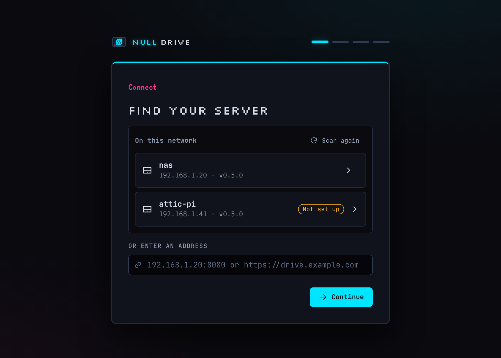 |  | 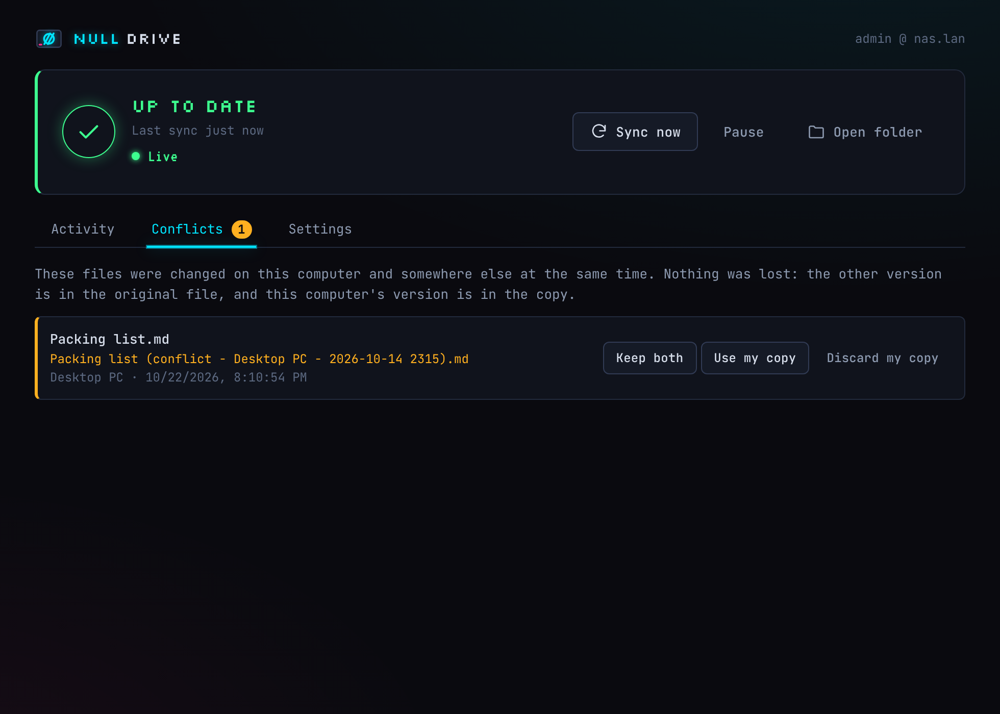 |

On Windows it comes as a per-user installer, built and checked in CI on every push:

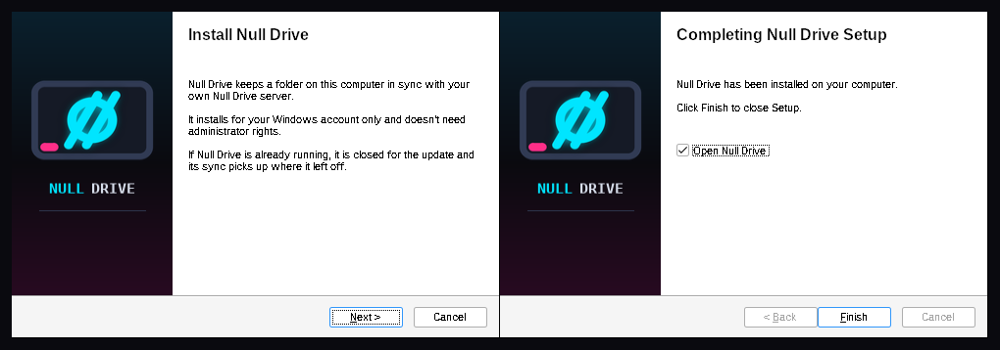

### Realtime, discovery and pairing

- **Changes show up in ~1–2 seconds.** Each device holds a WebSocket. When anything changes, the server pushes "feed is at version N" and the device pulls the change. Polling stays as a safety net when a proxy blocks WebSockets. The web file list and device list update live too.
- **Zero typing on a LAN.** The server announces itself with mDNS/DNS-SD (`_nulldrive._tcp`), and the desktop app lists it on first run. It handles multiple NICs and IPv6, and explains Docker/VLAN limits instead of failing silently.
- **One short code off the LAN.** *Add device* in the web app shows `NULL-7K2Q-9F` and a QR code: 5 minutes, single use, hashed at rest, brute-force rate limited. No password typed on the new computer.
- **Honest about transport security.** The app warns about plain HTTP to internet addresses and pins self-signed certificates by fingerprint (trust on first use).

| Add a device | Devices with live presence | Trust a self-signed server |
|---|---|---|
| 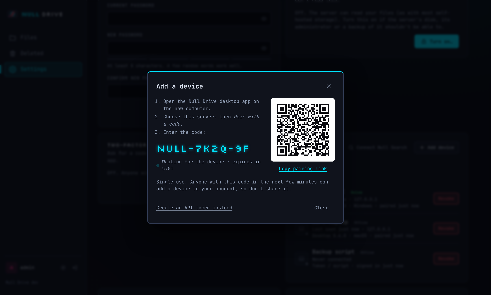 | 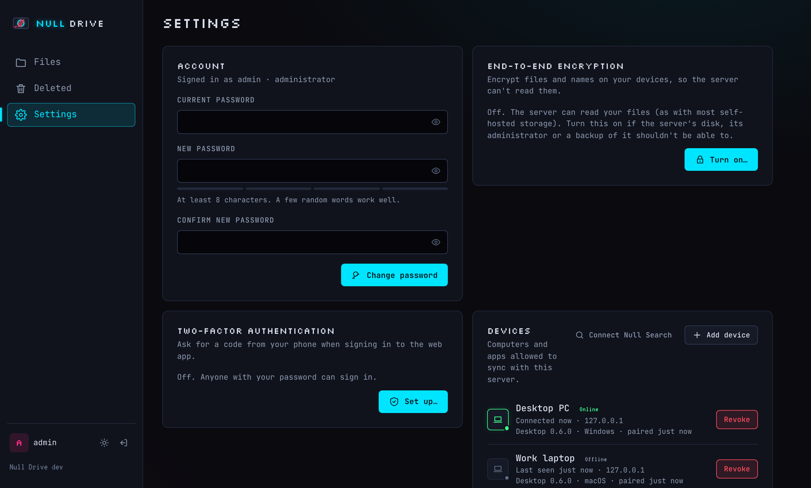 | 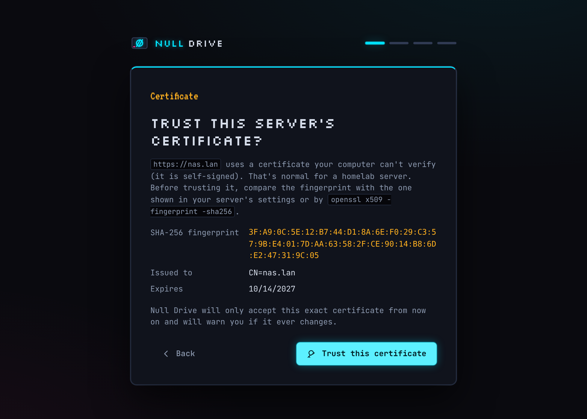 |

The networking decisions (push vs poll, keepalive timings, mDNS internals, pairing threat model, TOFU) are written up in [DESIGN.md › Phase 5](DESIGN.md#phase-5--realtime-push-pairing-lan-discovery).

### Delta sync, dedup and version history

- **Only the changed part travels.** Files are split with content-defined chunking (FastCDC), so a 1 MiB edit to a 1 GiB file uploads **4.5 MiB instead of 1024 MiB**, and even an *insertion* near the start (which shifts every byte after it) uploads only **2.3 MiB**. Downloads reuse chunks already on disk. Transfers run 4 chunks in parallel and resume after interruption. [Benchmarks](BENCHMARKS.md).
- **Stored once.** Identical chunks are stored once, across files, versions and users, without letting one user probe what another stores.
- **Every version, restorable.** Per-file history (who changed it, from which device, when), one-click restore that never rewrites history, and a 30-day *Recently deleted* trash. Retention: everything for 30 days, then daily for 90 (configurable), with hourly garbage collection that is safe against in-flight uploads.

| File history | Recently deleted | Storage and dedup |
|---|---|---|
|  | 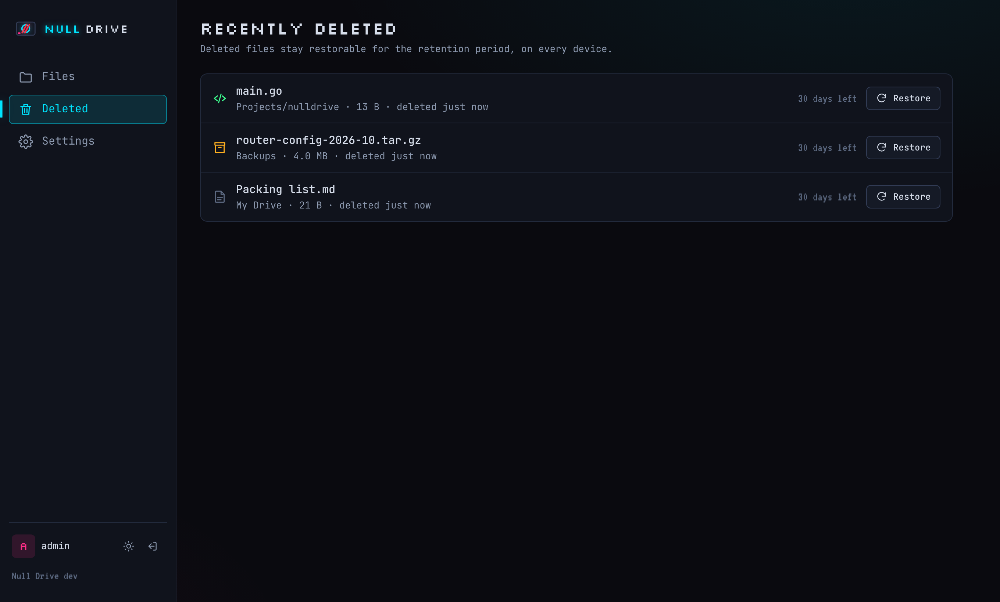 | 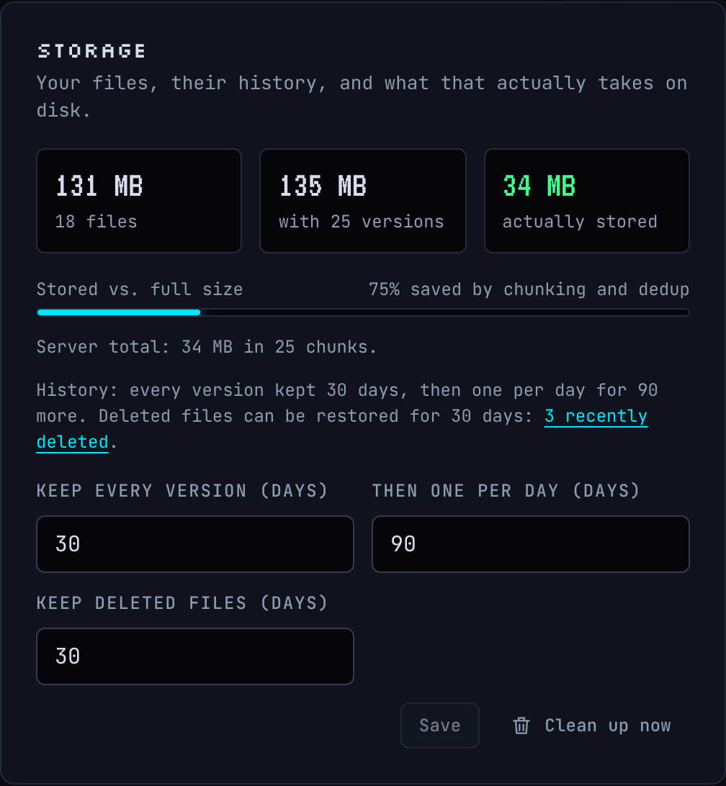 |

How it works (chunking diagram, manifest model, GC and retention): [DESIGN.md › Phase 6](DESIGN.md#phase-6--chunking-deduplication-version-history).

### End-to-end encryption and account security

- **Optional end-to-end encryption, per account.** Files *and* file names are encrypted on your devices (XChaCha20-Poly1305, Argon2id) before upload; the server, its admin and anyone holding its disks or backups see only ciphertext. Delta sync and dedup keep working, because chunks are encrypted deterministically *per account*, not convergently, so nobody can probe whether you store a known file. The web app decrypts in the browser (libsodium/WebAssembly), the desktop app keeps the key in the system keychain, and a printable recovery key is confirmed before anything is sent.
- **Turning it on encrypts what's already there**, then deletes every unencrypted copy (history included) from the database and disk. Tests scan every byte of the data directory afterwards.
- **Hardened sign-in:** two-factor codes with recovery codes, per-address rate limits, per-account lockout with backoff, CSRF tokens on top of SameSite cookies, strict CSP and HSTS, and a security log for the admin. Revoking a device cuts its live connection at once.
- **Honest threat model:** [docs/SECURITY.md](../SECURITY.md) says what's protected against a stolen laptop, a compromised server, the network and other users, and what isn't (sizes and folder structure stay visible; a malicious server can attack the *web* app).

| Recovery key, shown once | Unlocking in the browser | Two-factor setup |
|---|---|---|
| 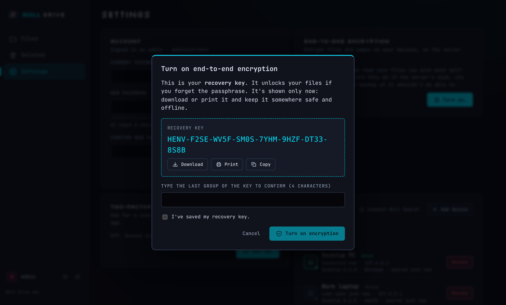 | 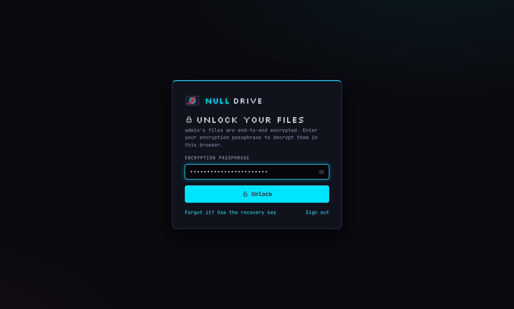 | 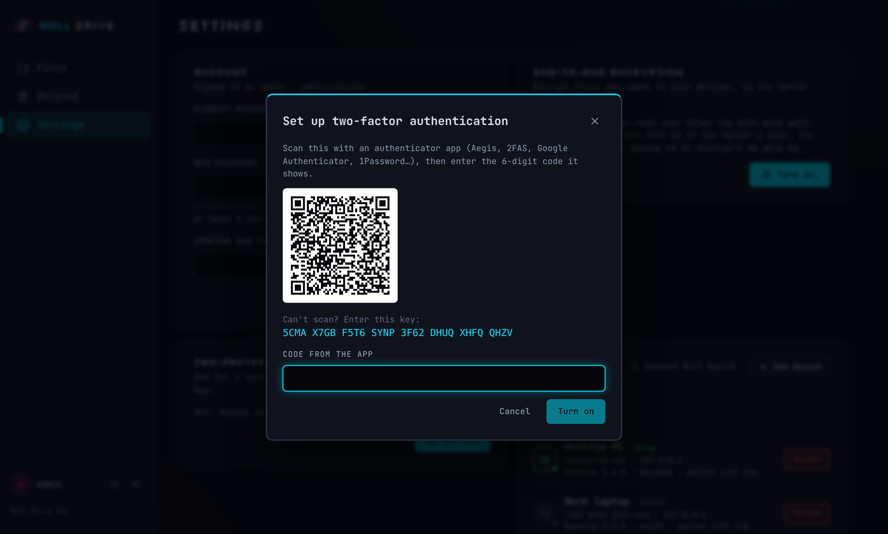 |

Design notes (SIV construction, why not convergent encryption, the migration, pairing and key transfer): [DESIGN.md › Phase 7](DESIGN.md#phase-7--end-to-end-encryption-and-the-security-pass). Vulnerability reports: [SECURITY.md](../SECURITY.md).

### Search across the Null apps

- **Your Drive in Null Search.** `GET /search` implements the Null franchise search contract: file names plus the text of Markdown, text and PDF files, case-insensitive and separator-tolerant (`libre ai` finds `LibreAI.md`), with snippets and stable file ids. Null Search calls it straight from your browser; queries never touch its server.
- **Private per account.** Every account has its own SQLite FTS5 index file; the account comes from the token, so a request can't name another user's index. Tests check user A never sees user B's files, and the E2EE scan checks no index survives encryption.
- **Search-only tokens.** *Connect Null Search* issues a token that can search and nothing else, safe to keep in a web page's storage.
- **Click a result, the file opens.** Results link to `nulldrive://open?id=…`; the desktop app (installer, portable or Microsoft Store build) resolves the id with the server and opens the file from your sync folder. A link can never run a program: executables and scripts are shown in their folder instead. No app or not synced yet? The web app's `/open` page shows it.
- **Synced notes dedupe.** Notes backed up from Null Notes carry the note's id (`synced_id`, read from the frontmatter on upload), so Null Search shows each note once.
- **Built for Notes backup.** Replace-by-path uploads (`If-Match: *`), device modification times, per-folder listings with hashes, and deletes that land in a 30-day trash ([docs/NOTES-BACKUP.md](NOTES-BACKUP.md)). Two-way sync with conditional writes everywhere ([docs/NOTES-SYNC.md](NOTES-SYNC.md)), into end-to-end encrypted accounts too: a published client protocol with a worked test vector and an independent Python reference client ([docs/NOTES-E2EE.md](NOTES-E2EE.md)).

Design notes: [DESIGN.md › Cross-product search](DESIGN.md#cross-product-search-null-franchise-phase-3).


## Highlights

- **One binary.** The Go server embeds the Svelte web UI and a SQLite database. No nginx, no separate frontend, no database server.
- **Never silently loses data.** Every write is version-checked. Two devices editing the same file get a `409 Conflict`, and the web UI keeps both copies instead of overwriting.
- **Content-addressed storage.** Content is stored as SHA-256-addressed chunks, so renames and moves are instant, duplicates are free, and file versions cost only what changed.
- **Setup in a minute.** Open the server in a browser and a wizard creates the admin account and shows where data lives.
- **Works on a phone.** Responsive layout with a bottom tab bar, bottom-sheet dialogs and large touch targets.
- **Neon Lab design.** Dark-first, with a light mode that's designed rather than inverted, and a component library shared with the desktop app.
- **No heavyweight dependencies.** WebSocket (RFC 6455) and mDNS/DNS-SD (RFC 6762/6763) are implemented on the Go standard library, with tests and a fuzzer.

| Setup wizard | Grid view | Phone |
|---|---|---|
| 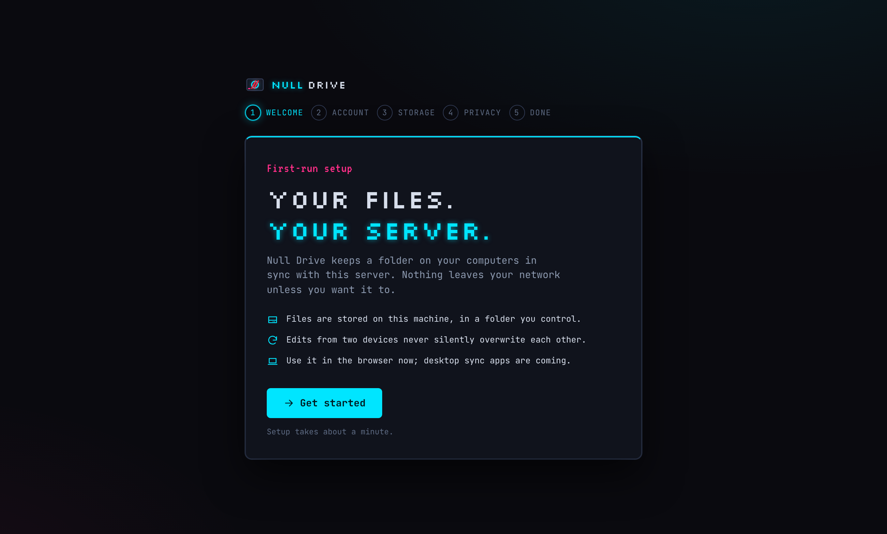 | 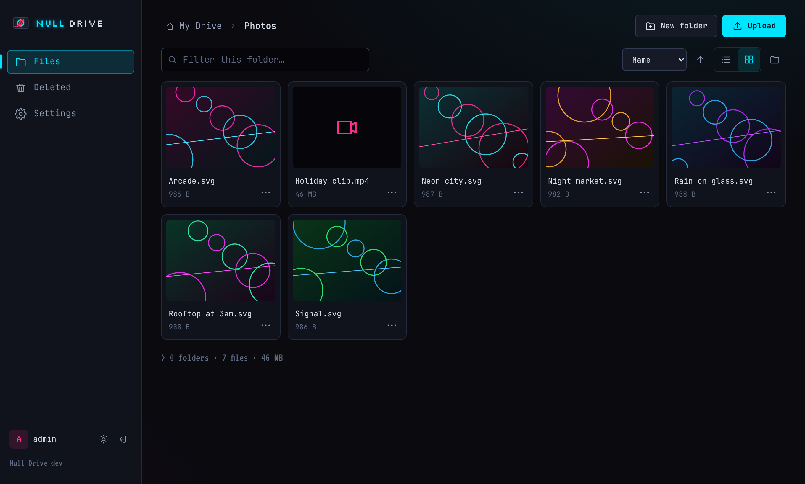 |  |
| 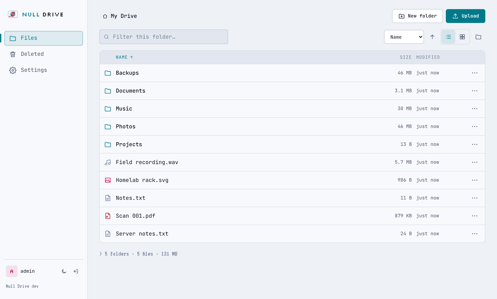 |  | 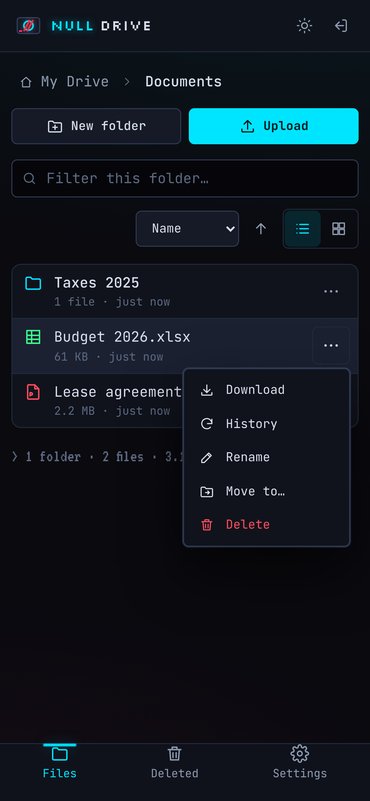 |

Why each piece is built the way it is: [docs/DESIGN.md](DESIGN.md).

## Build from source

Requires Go 1.24+ and Node 22+.

```bash
git clone https://github.com/Null0Grid/null-drive && cd null-drive
make run             # builds the UI + binary, serves on http://localhost:8080
```

Open <http://localhost:8080>: the setup wizard runs on first start. Data goes to `./data` unless you set `NULLDRIVE_DATA_DIR`.

Prefer the API? Everything the UI does is a documented REST call: see [docs/API.md](API.md) or run `make smoke` for a curl walkthrough.

## Configuration

| Variable | Default | Purpose |
|---|---|---|
| `NULLDRIVE_DATA_DIR` | `./data` | Database and file blobs |
| `NULLDRIVE_PORT` | `8080` | HTTP port |
| `NULLDRIVE_LOG_LEVEL` | `info` | `debug`, `info`, `warn`, `error` |
| `NULLDRIVE_TRUST_PROXY` | `off` | Take client IPs from `X-Forwarded-For` and HTTPS from `X-Forwarded-Proto` (for HSTS); only behind a reverse proxy |
| `NULLDRIVE_MDNS` | `on` | `off` disables LAN discovery regardless of the Settings toggle |
| `NULLDRIVE_ADVERTISE_ADDR` | auto | Comma-separated IPs to announce via mDNS (macvlan, reflectors) |
| `NULLDRIVE_ADVERTISE_PORT` | `NULLDRIVE_PORT` | Port to announce (when Docker maps a different host port) |
| `NULLDRIVE_GC_INTERVAL` | `1h` | How often old versions are pruned and unused chunks deleted |
| `NULLDRIVE_SEARCH_ORIGINS` | `https://search.nullgrid.dev` | Web origins allowed to call `GET /search` (CORS), comma-separated, or `off` |

Everything else is configured in the app and stored in the database.

## Development

```bash
make dev          # Go API on :8080 + Vite on :5173 with hot reload (open :5173)
make test         # Go tests + Vitest unit/component tests
make lint         # go vet + golangci-lint + svelte-check
make e2e          # Playwright against the real binary: wizard, login, files, pairing, live updates, 2FA, encryption
make smoke        # curl walkthrough of the API
make screenshots  # regenerate docs/screenshots
make build        # UI + static binary in bin/ (+ bin/nulldrive-e2ee, the encryption CLI)
make windows      # Windows installer + portable zip in dist/ (cross-built; needs makensis)
make icons        # regenerate every logo and icon from scripts/gen-icons.py
make docker       # container image for this machine (docker buildx)
```

CI also runs govulncheck, npm audit and CodeQL on every push and weekly (`.github/workflows/security.yml`, `codeql.yml`). Releases are automated: pushing a tag `vX.Y.Z` runs the full test suite, then publishes multi-arch images to GHCR and binaries with checksums to GitHub Releases. See [docs/DESIGN.md](DESIGN.md#release-pipeline).

## Repository layout

```
server/    Go server: cmd/nulldrive, api (v1 + v2), auth, meta (SQLite), storage, chunkstore (chunks, GC),
           webui (embedded UI), realtime (WebSocket hub, presence), discovery (mDNS advertiser),
           search (per-user FTS5 indexes, text extraction, GET /search)
shared/    Go packages shared with the desktop client: sync engine, API client (chunked transfers,
           realtime notifier), chunker (FastCDC), e2ee (end-to-end encryption), ws (RFC 6455),
           mdns (RFC 6762/6763), netutil, API types
cmd/       nulldrive-e2ee: turn on / migrate / manage end-to-end encryption from a terminal
ui/        Svelte 5 + Vite
  src/lib/   component library, design tokens, API client, crypto (libsodium + FastCDC port), drive: shared with the desktop app
  src/web/   the web app: routing, pages, dialogs
  e2e/       Playwright tests and screenshot generator
client/    Desktop app (Wails v2): setup flow, tray, keychain, watcher; own Go module
deploy/    docker-compose, CasaOS/Unraid/TrueNAS templates, store submission guide
docs/      API.md, DESIGN.md, INSTALL.md, STORE.md (Microsoft Store), SECURITY.md (threat model), BENCHMARKS.md, screenshots/,
           brand/ (logos), video/ (getting-started tutorial)
scripts/   smoke.sh, build-release.sh (server binaries), build-windows.sh (desktop installer), build-msix.sh (Store package),
           gen-icons.py (logos and icons), winget-manifest.py, tutorial-video.sh
Dockerfile multi-stage, multi-arch, distroless + non-root
```

