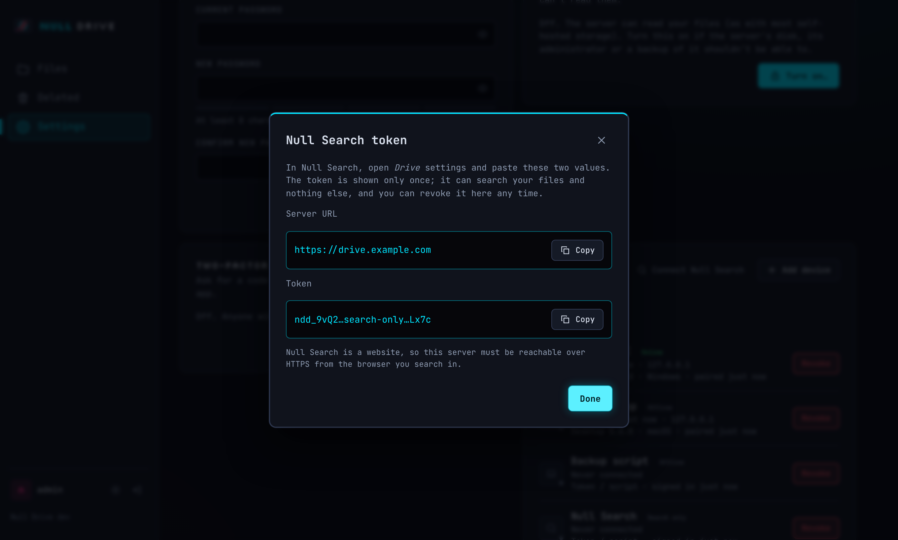

# Installing Null Drive

Null Drive is one container (or one binary) with the web UI built in. Pick a method, open `http://<server>:8080`, and finish the setup wizard.

> **Finish setup before exposing the server to the internet.** Until the admin account exists, whoever opens the page first can create it.

- [Docker (one command)](#docker-one-command)
- [Docker Compose](#docker-compose)
- [NAS app stores: CasaOS / ZimaOS, Unraid, TrueNAS SCALE](#nas-app-stores)
- [Plain binary](#plain-binary)
- [More accounts](#more-accounts)
- [Search from Null Search](#search-from-null-search)
- [HTTPS with a reverse proxy](#https-with-a-reverse-proxy)
- [Backup and restore](#backup-and-restore)
- [Upgrading](#upgrading)
- [Forgot the admin password](#forgot-the-admin-password)
- [Troubleshooting](#troubleshooting)

Images: `ghcr.io/null0grid/null-drive` for `linux/amd64` and `linux/arm64` (Raspberry Pi 4/5 with a 64-bit OS, Apple-silicon VMs, ARM VPSes). Tags: `latest`, `X.Y.Z`, `X.Y`, `vX.Y.Z`.

## Docker (one command)

```bash
docker run -d --name nulldrive -p 8080:8080 -v nulldrive-data:/data --restart unless-stopped ghcr.io/null0grid/null-drive:latest
```

`nulldrive-data` is a Docker-managed volume; everything (database + files) lives there.

## Docker Compose

```bash
curl -O https://raw.githubusercontent.com/Null0Grid/null-drive/main/deploy/docker-compose.yml
docker compose up -d
```

The file is commented line by line. Common changes:
- **Different host port:** `"9000:8080"`.
- **Store files in a specific folder** instead of a named volume: `- /srv/nulldrive:/data`, then make it writable for the container user:
  ```bash
  sudo mkdir -p /srv/nulldrive && sudo chown 65532:65532 /srv/nulldrive
  ```
  or keep your own ownership and run the container as you: `user: "1000:1000"`.

## NAS app stores

Templates live in [`deploy/`](../deploy); [`deploy/SUBMITTING.md`](../deploy/SUBMITTING.md) explains publishing them upstream. Until they're in the official stores, install them manually:

### CasaOS / ZimaOS
App Store → **Custom Install** → Import → paste [`deploy/casaos/Apps/NullDrive/docker-compose.yml`](../deploy/casaos/Apps/NullDrive/docker-compose.yml). Data goes to `/DATA/AppData/nulldrive/data`.

### Unraid
Docker → Add Container → *Template* field: paste the raw URL of [`deploy/unraid/nulldrive.xml`](../deploy/unraid/nulldrive.xml) (or save it to `/boot/config/plugins/dockerMan/templates-user/my-nulldrive.xml` and pick it from the list). Data goes to `/mnt/user/appdata/nulldrive`; the container runs as `nobody:users` like other Unraid apps.

### TrueNAS SCALE (24.10+)
1. Create a dataset (e.g. `pool/apps/nulldrive`) and set its owner user/group to **apps** (568).
2. Apps → Discover Apps → ⋮ → **Install via YAML** → paste [`deploy/truenas/docker-compose.yaml`](../deploy/truenas/docker-compose.yaml), with the host path changed to your dataset.

## Debian / Ubuntu package (.deb)

```bash
sudo apt install ./nulldrive_X.Y.Z_amd64.deb      # or _arm64.deb (Raspberry Pi OS 64-bit, ZimaBoard, …)
```
It creates a `nulldrive` system user, keeps data in `/var/lib/nulldrive`, and starts the `nulldrive` service on port 8080: open `http://<server>:8080` and create the admin account right away. Settings live in `/etc/default/nulldrive` (kept on upgrade); `sudo systemctl restart nulldrive` after a change. Upgrading is installing the newer `.deb` the same way. Removing (even `apt purge`) never deletes `/var/lib/nulldrive`.

Admin commands run as the service user:
```bash
sudo -u nulldrive NULLDRIVE_DATA_DIR=/var/lib/nulldrive nulldrive reset-password admin
```

## Snap (the server as a service)

```bash
sudo snap install --dangerous ./nulldrive_X.Y.Z_amd64.snap   # or _arm64.snap; from the release
```
The service (`nulldrive.server`) starts right away on port 8080 and starts with the machine: open `http://<server>:8080` and create the admin account. Data is in `/var/snap/nulldrive/common` and survives upgrades and `snap revert`. `--dangerous` is needed because the file comes from the release, not the Snap Store (see [PACKAGING.md](PACKAGING.md) to publish it there).

```bash
sudo snap set nulldrive port=8080          # HTTP port; the service restarts to apply it
sudo snap set nulldrive mdns=off           # don't announce the server on the LAN
sudo snap set nulldrive trust-proxy=on     # behind a reverse proxy
sudo snap set nulldrive search-origins=https://search.nullgrid.dev
sudo snap set nulldrive log-level=debug    # debug | info | warn | error
sudo snap get nulldrive                    # current settings
sudo snap logs nulldrive -n 50             # the service log
sudo nulldrive reset-password admin        # admin commands, with the snap's data
```
Upgrading is installing the newer `.snap` the same way. `sudo snap remove nulldrive` keeps a snapshot of the data for 31 days (`snap saved`); `--purge` deletes it.

## Arch Linux (AUR)

`nulldrive-bin` is the server and `nulldrive-desktop-bin` the desktop app. Once they're on the AUR: `yay -S nulldrive-bin` (or `paru`, or `git clone https://aur.archlinux.org/nulldrive-bin.git && cd nulldrive-bin && makepkg -si`). Until then, or for a specific version, the release has both as `nulldrive_X.Y.Z_aur.tar.gz`:

```bash
tar -xzf nulldrive_X.Y.Z_aur.tar.gz
cd nulldrive-bin && makepkg -si                  # downloads the release archive, checks its sha256
sudo systemctl enable --now nulldrive            # then open http://localhost:8080
```
The server runs as the `nulldrive` user (created by `systemd-sysusers`) with data in `/var/lib/nulldrive` and settings in `/etc/conf.d/nulldrive` (kept on upgrade). Admin commands: `sudo -u nulldrive NULLDRIVE_DATA_DIR=/var/lib/nulldrive nulldrive help`. Both packages are for x86_64 and aarch64.

## Docker image from a file (no registry)

Each release also has `nulldrive_X.Y.Z_docker_amd64.tar` / `_arm64.tar`, for machines that can't pull from ghcr.io:
```bash
docker load -i nulldrive_X.Y.Z_docker_amd64.tar      # → nulldrive:X.Y.Z and nulldrive:latest
docker run -d --name nulldrive -p 8080:8080 -v nulldrive-data:/data --restart unless-stopped nulldrive:X.Y.Z
```
In the compose files, replace `ghcr.io/null0grid/null-drive:…` with `nulldrive:X.Y.Z`. The image is the same runtime as the published one (non-root user 65532, `/data`, built-in healthcheck); `scripts/build-image-offline.sh` builds it without pulling anything.

## Plain binary

Downloads for Linux, macOS and Windows (amd64/arm64) are attached to every [GitHub Release](https://github.com/Null0Grid/null-drive/releases), with `SHA256SUMS.txt`.

```bash
tar xzf nulldrive_X.Y.Z_linux_amd64.tar.gz
sha256sum -c SHA256SUMS.txt --ignore-missing
NULLDRIVE_DATA_DIR=/var/lib/nulldrive ./nulldrive_X.Y.Z_linux_amd64/nulldrive
```

As a systemd service (`/etc/systemd/system/nulldrive.service`):

```ini
[Unit]
Description=Null Drive
After=network-online.target
Wants=network-online.target

[Service]
ExecStart=/usr/local/bin/nulldrive
Environment=NULLDRIVE_DATA_DIR=/var/lib/nulldrive
Environment=NULLDRIVE_PORT=8080
DynamicUser=yes
StateDirectory=nulldrive
Restart=on-failure
TimeoutStopSec=35
# Hardening
NoNewPrivileges=yes
ProtectSystem=strict
ProtectHome=yes
PrivateTmp=yes
CapabilityBoundingSet=

[Install]
WantedBy=multi-user.target
```

```bash
sudo install -m 755 nulldrive /usr/local/bin/ && sudo systemctl enable --now nulldrive
```

## Configuration

Environment variables (in the `.deb`: `/etc/default/nulldrive`). Everything else is set in the app and stored in the database.

| Variable | Default | Purpose |
|---|---|---|
| `NULLDRIVE_DATA_DIR` | `./data` (`/data` in the image, `/var/lib/nulldrive` in the `.deb`) | Database and file blobs |
| `NULLDRIVE_PORT` | `8080` | HTTP port |
| `NULLDRIVE_LOG_LEVEL` | `info` | `debug`, `info`, `warn`, `error` |
| `NULLDRIVE_TRUST_PROXY` | `off` | Take client IPs from `X-Forwarded-For` and HTTPS from `X-Forwarded-Proto` (for HSTS); only behind a reverse proxy |
| `NULLDRIVE_MDNS` | `on` | `off` disables LAN discovery regardless of the Settings toggle |
| `NULLDRIVE_ADVERTISE_ADDR` | auto | Comma-separated IPs to announce via mDNS (macvlan, reflectors) |
| `NULLDRIVE_ADVERTISE_PORT` | `NULLDRIVE_PORT` | Port to announce (when Docker maps a different host port) |
| `NULLDRIVE_GC_INTERVAL` | `1h` | How often old versions are pruned and unused chunks deleted |
| `NULLDRIVE_SEARCH_ORIGINS` | `https://search.nullgrid.dev` | Web origins allowed to call `GET /search` (CORS), comma-separated, or `off` |

## LAN discovery (mDNS) and Docker networking

The server announces itself on the local network as `_nulldrive._tcp`, so the desktop app's first-run screen lists it ("nas · 192.168.1.20") with no typing. It's on by default. Turn it off or rename the server in **Settings → LAN discovery** (admins), or force it off with `NULLDRIVE_MDNS=off`.

**Docker:** multicast does not cross Docker's default bridge network, and inside a bridge the container only knows its `172.17.x.x` address. For discovery, use host networking (Linux only):

```yaml
services:
  nulldrive:
    image: ghcr.io/null0grid/null-drive:latest
    network_mode: host          # mDNS needs to be on the LAN; `ports:` is ignored in this mode
    environment:
      NULLDRIVE_PORT: "8080"    # the port is now opened directly on the host
    volumes: [nulldrive-data:/data]
```

If you keep the bridge network, discovery simply won't find the server (Settings shows a warning). Add devices with the address or a pairing code instead. Behind macvlan/ipvlan or a host-side mDNS reflector, `NULLDRIVE_ADVERTISE_ADDR=192.168.1.20` and `NULLDRIVE_ADVERTISE_PORT=443` set exactly what is announced. Docker Desktop (macOS/Windows) can't do host networking for this.

**VLANs / subnets:** mDNS is link-local and never crosses a router. To discover a server on another VLAN, enable your router's mDNS reflector/repeater (UniFi: *Multicast DNS*; OPNsense/pfSense: *mdns-repeater* or Avahi; Linux: Avahi `enable-reflector=yes`). Otherwise use the address or a pairing link.

**Firewall:** the server needs UDP 5353 inbound from the LAN. The desktop app needs nothing inbound: it queries from an ephemeral port and responders reply directly to it.

## Desktop app (Windows)

Download `NullDrive-<version>-Setup.exe` from the [latest release](https://github.com/Null0Grid/null-drive/releases/latest) and run it. It installs for your Windows account only (no administrator prompt), adds Null Drive to the Start menu, and opens it at the end. Windows 10 (1809+) or 11, 64-bit.

- **SmartScreen:** until releases are code-signed, Windows may say it "protected your PC". Choose *More info → Run anyway*. Verify the file against `SHA256SUMS.txt` in the release if you like: `Get-FileHash NullDrive-*-Setup.exe`.
- **Updating:** run the newer installer. It closes the running app cleanly first; your settings and sync state are kept.
- **No installer:** the release also has `NullDrive-<version>-portable.zip`, the same app as a portable `.exe`.
- **Microsoft Store:** [Null Drive in the Store](https://apps.microsoft.com/detail/9P3NQGJ8ZZMG) updates itself and has no SmartScreen step. It keeps its own settings, so install either it or the installer, not both ([STORE.md](STORE.md)).
- **Links:** all three register `nulldrive://` links (Null Search results) for your account; see [Search from Null Search](#search-from-null-search).
- **Uninstalling:** *Settings → Apps → Null Drive → Uninstall*. Your synced folder is never deleted; you're asked whether to also remove settings and the saved sign-in.
- **winget:** once the package is accepted into the winget repository, `winget install NULLGRID.NullDrive`. The manifests are attached to every release (submitting them: [client/README.md](../client/README.md)).
- **Silent install** (for scripts or deployment tools): `NullDrive-<version>-Setup.exe /S`, uninstall with `"%LOCALAPPDATA%\Programs\Null Drive\Uninstall Null Drive.exe" /S`.

## Desktop app (Linux)

The same tray app, for x86_64 and arm64 (`aarch64`). Every [release](https://github.com/Null0Grid/null-drive/releases/latest) has it in five forms; pick one:

| File | For | How |
|---|---|---|
| `NullDrive-<version>-x86_64.AppImage` | any distro, nothing to install | `chmod +x NullDrive-*.AppImage && ./NullDrive-*.AppImage` |
| `nulldrive-desktop_<version>_amd64.deb` | Debian, Ubuntu, Mint, Pop!_OS | `sudo apt install ./nulldrive-desktop_*_amd64.deb` |
| `nulldrive-desktop-<version>-1.x86_64.rpm` | Fedora, RHEL/Alma/Rocky 10, openSUSE | `sudo dnf install ./nulldrive-desktop-*.rpm` (openSUSE: `sudo zypper install`) |
| `nulldrive-desktop_<version>_linux_amd64.tar.gz` | anything else, or no root | unpack, then `./install.sh` (installs to `~/.local` for you only; `./install.sh --uninstall` removes it) |
| `NullDrive-<version>-x86_64.flatpak` | any distro with Flatpak, sandboxed | `flatpak install ./NullDrive-*.flatpak`, then `flatpak run dev.nullgrid.NullDrive` or the app menu |

Arch Linux: `nulldrive-desktop-bin` ([AUR](#arch-linux-aur)).

(`arm64`/`aarch64` in the name for ARM.)

- **Requirements:** WebKitGTK 4.1 and GTK 3, which GNOME, KDE Plasma, Cinnamon, XFCE and MATE desktops already have. The `.deb` and `.rpm` pull them in. For the AppImage or the archive on a minimal system: `sudo apt install libwebkit2gtk-4.1-0` or `sudo dnf install webkit2gtk4.1`. The AppImage doesn't bundle WebKitGTK: the copy your distro ships gets its security updates.
- **Sign-in:** the device token is kept in the desktop keyring (Secret Service: GNOME Keyring or KWallet), like the Windows app uses Credential Manager. Settings are in `~/.config/Null Drive/`, and the sync folder is `~/NullDrive` by default.
- **Tray icon:** the app sits in the tray when its window is closed. KDE, Cinnamon, XFCE and MATE show it as is; stock GNOME needs the *AppIndicator and KStatusNotifierItem Support* extension (preinstalled on Ubuntu). Without a tray, start Null Drive again from the app menu to bring its window back.
- **Links:** the `.deb`, `.rpm` and `install.sh` register `nulldrive://` links (Null Search results). The AppImage registers itself for your account the first time it runs, pointing at wherever the AppImage file is; if you move it, run it once from the new place.
- **Start on login:** *Settings* in the app (it writes `~/.config/autostart/nulldrive-desktop.desktop`).
- **Updating:** install the newer package or replace the AppImage. Settings and sync state are kept.
- **Flatpak:** brings its own WebKitGTK (the GNOME runtime, fetched from Flathub on install), so it has no requirements. Its sandbox can reach `~/NullDrive` (the sync folder), the network, the keyring and the tray, nothing else. To sync a different folder, allow it once: `flatpak override --user --filesystem=/path/to/folder dev.nullgrid.NullDrive`; settings are in `~/.var/app/dev.nullgrid.NullDrive/config/Null Drive/`. Start on login goes through the desktop's background-apps permission, which asks once. Updating: install the newer `.flatpak`, or `flatpak update` once it's on Flathub.
- **Uninstalling:** `sudo apt remove nulldrive-desktop` / `sudo dnf remove nulldrive-desktop` / `flatpak uninstall dev.nullgrid.NullDrive`, or delete the AppImage. Your synced folder is never deleted; settings stay in `~/.config/Null Drive/`.

## Adding devices

- **Same LAN:** install the desktop app; it lists the server. Pick it, then sign in or pair.
- **Anywhere:** in the web app open **Settings → Devices → Add device**. You get a code like `NULL-7K2Q-9F` (valid 5 minutes, single use) plus a QR code and a copyable pairing link. In the desktop app choose the server (or paste the link) → *Pair with a code*. No password is typed on the new device.
- **Scripts:** *Add device → Create an API token instead*.

Every device is listed with online status, last address and app version, and can be revoked at any time. Revoking disconnects it immediately.

## More accounts

Each account has its own files, devices and search index. Create one from the server's shell; it prints a random password to hand over (the user can change it in Settings):

```bash
docker exec nulldrive /nulldrive add-user alex
# plain binary:
NULLDRIVE_DATA_DIR=/var/lib/nulldrive nulldrive add-user alex
```

## Search from Null Search

Null Drive indexes each account's file names and the text of `.md`, `.txt` and `.pdf` files, so [Null Search](https://search.nullgrid.dev) can show your files in its results. Each account has its own index file (`<data dir>/indexes/<user id>.db`); nothing is shared between accounts and nothing is sent to Null Search's server: your browser asks your Drive directly.

1. In the web app: **Settings → Devices → Connect Null Search → Create token**. This token can only search: it can't open, download, change or delete files.
2. In Null Search: **Drive** settings → paste the server URL and the token.

Requirements and notes:

- Null Search is an HTTPS site, so the browser must reach Null Drive over **HTTPS** (see the reverse proxy section below). A plain-HTTP LAN address is blocked as mixed content. Chrome may also ask once for permission to access devices on your local network: allow it.
- Using your own Null Search build or a dev server? Set `NULLDRIVE_SEARCH_ORIGINS=https://search.nullgrid.dev,http://localhost:3000`.
- Accounts with end-to-end encryption aren't searchable: the server can't read them, and turning encryption on deletes the account's index.
- The index catches up on its own (after a restart, or if you delete `indexes/`, it's rebuilt). Large PDFs (over 64 MB) are found by name only.



**Opening results.** Clicking a Drive result in Null Search opens a `nulldrive://` link: with the desktop app installed (installer, portable or Store), the file opens from your sync folder. The browser asks once whether to allow Null Search to open Null Drive. Programs and scripts are shown in their folder instead of being run. Without the desktop app, or if the file isn't on that computer, the app offers the web app instead (`https://<your server>/open?id=…`).

## HTTPS with a reverse proxy

Null Drive speaks plain HTTP; put it behind a proxy for HTTPS. When the proxy sets `X-Forwarded-Proto: https` (all examples below do), the session cookie is marked `Secure` automatically. Uploads are streamed with no size limit, so make sure the proxy doesn't impose one.

### Caddy (automatic Let's Encrypt)

```caddyfile
drive.example.com {
	reverse_proxy nulldrive:8080
}
```

Caddy has no request-body limit by default and handles WebSockets (realtime sync at `/api/v1/ws`) automatically.

### Traefik (Docker labels)

```yaml
services:
  nulldrive:
    image: ghcr.io/null0grid/null-drive:latest
    volumes: [nulldrive-data:/data]
    labels:
      - traefik.enable=true
      - traefik.http.routers.nulldrive.rule=Host(`drive.example.com`)
      - traefik.http.routers.nulldrive.entrypoints=websecure
      - traefik.http.routers.nulldrive.tls.certresolver=letsencrypt
      - traefik.http.services.nulldrive.loadbalancer.server.port=8080
    networks: [proxy]
```

Don't attach a `buffering` middleware with `maxRequestBodyBytes` to this router, or large uploads will fail. Traefik passes WebSockets with no extra configuration.

Behind any proxy, set `NULLDRIVE_TRUST_PROXY=on` so device IPs and the pairing rate limit use the real client address (the last `X-Forwarded-For` hop). Leave it off when the server is reached directly, or clients could spoof their address.

**Self-signed certificates** (e.g. a homelab CA or the proxy's default cert): the desktop app shows the certificate's SHA-256 fingerprint on first connect and asks you to trust it, then accepts only that exact certificate. Compare it with `openssl x509 -in cert.pem -noout -fingerprint -sha256`. The app also warns if you connect with plain `http://` to an internet address.

### nginx

```nginx
server {
    listen 443 ssl;
    server_name drive.example.com;
    # ssl_certificate ... ;

    client_max_body_size 0;          # no upload limit
    proxy_request_buffering off;     # stream uploads instead of spooling them to disk
    proxy_read_timeout 1h;

    location / {
        proxy_pass http://127.0.0.1:8080;
        proxy_set_header Host $host;
        proxy_set_header X-Forwarded-Proto $scheme;
        proxy_set_header X-Forwarded-For $proxy_add_x_forwarded_for;
        # WebSockets (realtime sync at /api/v1/ws). The server pings every
        # 25 s, well under proxy_read_timeout, so idle sockets stay open.
        proxy_http_version 1.1;
        proxy_set_header Upgrade $http_upgrade;
        proxy_set_header Connection "upgrade";
    }
}
```

## Backup and restore

Everything is in the data directory: `nulldrive.db` (+ `-wal`/`-shm`), `blobs/` (file contents as deduplicated chunks, shared by all versions), `indexes/` (search indexes, one per account; optional in a backup, they rebuild themselves) and `tmp/`. **Back up the database and `blobs/` together**: one without the other isn't usable. If you copy them while the server runs without a filesystem snapshot, copy the database *first*: the garbage collector only deletes chunks nothing references, so blobs copied afterwards are a superset of what that database needs. Stop the container for a consistent copy (it takes a second):

```bash
docker stop nulldrive
docker run --rm -v nulldrive-data:/data:ro -v "$PWD":/backup alpine \
  tar czf /backup/nulldrive-$(date +%F).tar.gz -C /data .
docker start nulldrive
```

Restore into a fresh volume:

```bash
docker stop nulldrive && docker rm nulldrive
docker volume create nulldrive-data-restored
docker run --rm -v nulldrive-data-restored:/data -v "$PWD":/backup alpine \
  sh -c 'tar xzf /backup/nulldrive-YYYY-MM-DD.tar.gz -C /data && chown -R 65532:65532 /data'
docker run -d --name nulldrive -p 8080:8080 -v nulldrive-data-restored:/data --restart unless-stopped ghcr.io/null0grid/null-drive:latest
```

With a bind mount, back up the host folder with any tool you like (restic, borg, ZFS snapshots…) while the container is stopped, or snapshot the filesystem atomically (ZFS/Btrfs/LVM snapshots are consistent even while running).

## End-to-end encryption

Optional, per account: **Settings → End-to-end encryption → Turn on…** (also offered at the end of the setup wizard). Files and their names are then encrypted on your devices; the server and anyone with its disk or backups can't read them. Before it does anything you'll get a **recovery key**: download or print it and keep it offline. If you lose both the passphrase and the recovery key, the files can't be recovered by anyone, including whoever runs the server (`reset-password` resets the *login* password only).

- **Existing files** are re-encrypted from the browser tab that turns it on (it can be interrupted and resumed), then the server deletes the unencrypted copies *including their history and Recently deleted*. For large accounts, or a headless setup, use the command-line tool instead (built with `make build` as `bin/nulldrive-e2ee`, or `go run ./cmd/nulldrive-e2ee`):

  ```bash
  nulldrive-e2ee -server https://drive.example.com -user alice enable     # prompts for password + passphrase
  nulldrive-e2ee -server https://drive.example.com -user alice migrate    # resume if interrupted
  nulldrive-e2ee -server … -user alice passphrase | recovery-key | verify | status
  ```
- **Each desktop app** asks for the passphrase once and keeps the key in the system keychain; older desktop apps (before 0.7) stop with "update Null Drive" instead of syncing.
- **The web app** asks again after every reload (the key lives only in that tab's memory). Thumbnails are off for encrypted files.
- **Backups** of the data directory stay encrypted. Keep the recovery key separately from them. Earlier backups taken before you turned encryption on still contain the plaintext: rotate them out.

What it does and doesn't hide (sizes and folder structure are still visible to the server, among others): [SECURITY.md](SECURITY.md).

## Two-factor authentication

**Settings → Two-factor authentication → Set up…** shows a QR code for any authenticator app (Aegis, 2FAS, Google Authenticator, 1Password…). Save the 10 recovery codes it gives you. Desktop apps you already added keep syncing. If you lose the phone *and* the codes, someone with shell access to the server can turn it off (see Troubleshooting).

Sign-in is limited to 10 attempts per minute per address, and an account locks for 30 s after 5 failures, doubling up to 15 minutes. **Settings → Security log** (admins) lists sign-ins, failures, lockouts, device and settings changes.

## Version history and disk usage

Every change to a file is kept as a version: everything for 30 days, then one version per day for 90 more days. Deleted files go to Recently deleted and stay restorable for 30 days. Change this under **Settings → Storage** (admins). Because files are stored as deduplicated chunks, versions only cost the parts that changed. The same card shows how much space history and dedup actually take. Old versions and unused chunks are cleaned up hourly (`NULLDRIVE_GC_INTERVAL=6h` to change that, or *Clean up now*). Chunks that were uploaded but never committed are kept for 24 hours so interrupted uploads can resume.

Upgrading from 0.5 or earlier converts existing files on first start (a few seconds, no data is copied: each old file becomes a single-chunk version). Back up first, as with any upgrade.

## Upgrading

```bash
docker compose pull && docker compose up -d        # compose
# or
docker pull ghcr.io/null0grid/null-drive:latest && docker stop nulldrive && docker rm nulldrive && docker run -d ...   # same run command as before
```

- Database migrations run automatically on start.
- **Back up before upgrading.** Downgrading after a release with a new migration is not supported; restore the backup instead.
- Pin a version tag (`:0.3.0`) instead of `:latest` if you want to choose when to upgrade. Release notes list anything that needs attention.

## Forgot the admin password

```bash
docker exec nulldrive /nulldrive reset-password admin
```

It prints a new random password and signs that user out of every browser. (Works for any account, not just the admin.) Synced devices keep working. With the plain binary: `NULLDRIVE_DATA_DIR=... nulldrive reset-password admin`.

## Troubleshooting

| Symptom | Fix |
|---|---|
| Container exits with `data dir /data is not writable … chown` | The bind-mounted folder isn't writable by the container user. Run the `chown` shown in the log, or set `user:` to the folder owner. |
| `docker ps` shows `unhealthy` | `docker logs nulldrive`; the health check calls `/api/v1/health` inside the container. |
| Uploads fail at a certain size behind a proxy | Remove the proxy's body size limit (`client_max_body_size 0` in nginx). |
| Logged out on every request behind HTTPS | The proxy must pass `Host` and `X-Forwarded-Proto`. |
| Desktop app doesn't list the server | Same subnet/VLAN? Docker needs `network_mode: host`. Check Settings → LAN discovery for the announced addresses, or run `avahi-browse -rt _nulldrive._tcp`. Enter the address manually or pair with a code meanwhile. |
| Desktop app shows *Polling* instead of *Live* | A proxy is not passing WebSocket upgrades to `/api/v1/ws` (nginx needs the `Upgrade`/`Connection` headers above). Sync still works, with up to 30 s delay. |
| "too many pairing attempts" | Wait a minute: claims are limited to 5/min per address and 30/min overall. |
| "certificate changed since you trusted it" | If you replaced the certificate yourself, sign out of the desktop app and connect again to trust the new fingerprint. If not, someone may be intercepting the connection. |
| "too many failed sign-ins for this account" | Wait the time shown (at most 15 minutes). Check Settings → Security log afterwards for where the attempts came from. |
| Lost the authenticator and all 2FA recovery codes | `docker exec nulldrive /nulldrive disable-2fa admin` (plain binary: `NULLDRIVE_DATA_DIR=... nulldrive disable-2fa admin`), sign in with the password and set it up again. It's recorded in the security log. |
| Desktop app says "update Null Drive on this device" | The account uses end-to-end encryption and that app predates it. Install the current version. |
| Behind HTTPS but no HSTS header | Set `NULLDRIVE_TRUST_PROXY=on` when (and only when) a reverse proxy sets `X-Forwarded-Proto`. |
| Which version am I running? | Shown at the bottom of the sidebar, in Settings → Server, at `/api/v1/health`, or `docker exec nulldrive /nulldrive version`. |
